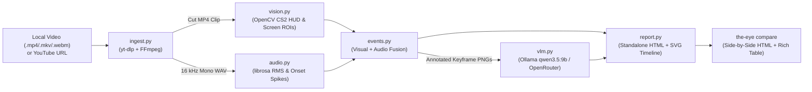

# The-Eye

Counter-Strike 2 (CS2) gameplay visual & audio analyzer that processes recorded POV footage (local files or YouTube URLs) using **FFmpeg**, **OpenCV**, **librosa**, and optional **Vision-Language Models (local Ollama `qwen3.5:9b` or OpenRouter)** to detect key engagements, killfeed events, flashbangs, and scoped duels—and compare two recordings side-by-side.

---

## Architecture



### What It Measures & Coaches
- **CS2 Mechanics Scorecard (0–100, Zero-LLM Deterministic CV + Audio):**
  - **Crosshair Discipline (`vision.py` / `mechanics.py`):** Uses **OpenCV Farneback Dense Optical Flow** on the center viewport to measure horizontal pre-aim stability vs. vertical bounce (`vertical_jitter`).
  - **Counter-Strafe & Shot Coordination:** Measures camera velocity right before and during every gunfire audio spike to score stabilized counter-strafed shots vs. run-and-gun movement.
  - **Sound-Cue Awareness & Reaction Time (ms):** Measures the latency (`ms`) between audio cues (footsteps, utility, enemy shots) and directional aim-flick responses.
  - **Team & Utility Coordination:** Detects kill-trade windows (`<= 4.0s` between killfeed events), flash-to-entry combos (`<= 4.0s`), and top-left **Radar ROI** rotation activity.
  - **Targeted Practice Drills:** Generates concrete CS2 practice recommendations directly from the player's lowest-scoring mechanics.
- **On-Screen HUD & Combat Event Detection:**
  - **Killfeed Events (`killfeed_event`):** Top-right Killfeed ROI (`x: 0.74..0.99`, `y: 0.04..0.28`) with vivid crimson HSV filtering (`S >= 165, V >= 150`) to avoid Mirage/Dust2 sandstone false positives.
  - **Damage Taken (`damage_taken`):** Detects CS2's directional red damage arc around the mid-screen ring.
  - **Flashbang Whiteouts (`flashbang`):** High luminance (`V >= 215`) + low saturation (`S <= 45`).
  - **Sniper Scope Vignette (`scoped_duel`):** Four dark outer screen corners (`mean < 22`) + bright center reticle (`mean > 35`).
- **3-Frame Pre-Duel Filmstrips & VLM Coaching:** Stitches `1. APPROACH (-1.5s) | 2. CONTACT (-0.5s) | 3. OUTCOME (0.0s)` strips for every major duel and sends them with the Mechanics Scorecard to local **Ollama (`qwen3.5:9b`)** or **OpenRouter** to diagnose *why* duels were won or lost.

---

## Quick Start

### Prerequisites
- Python `3.12+` and [`uv`](https://docs.astral.sh/uv/)
- `ffmpeg` available on `PATH`
- Optional: [Ollama](https://ollama.com/) (`ollama pull qwen3.5:9b`) or an `OPENROUTER_API_KEY` in `.env` for VLM tactical coaching (or pass `--no-vlm` for pure OpenCV + `librosa`).

### Install
```bash
uv sync --extra dev
cp .env.example .env
```

### Analyze a CS2 Video (YouTube URL or Local File)
Supported local formats: `.mp4`, `.mkv`, `.webm`, `.mov`, `.avi` — or any public YouTube URL.

```bash
# Example 1: Pro Major CS2 POV (donk — Spirit vs MOUZ on Mirage)
uv run the-eye analyze "https://www.youtube.com/watch?v=sZBzpFwhBNY" \
  --title "Pro Major POV - donk Mirage" \
  --start 120 --duration 35 --fps 2.0 \
  --model "ollama:qwen3.5:9b" \
  --out output/pro_major_mirage

# Example 2: Amateur / Premier CS2 POV (Mirage, No Commentary)
uv run the-eye analyze "https://www.youtube.com/watch?v=ODPp5e-7vGo" \
  --title "Premier POV - Mirage" \
  --start 120 --duration 35 --fps 2.0 \
  --model "ollama:qwen3.5:9b" \
  --out output/premier_mirage

# Pure CV + Audio mode (no VLM required)
uv run the-eye analyze path/to/my_cs2_clip.mp4 --title "My Mirage Clip" --no-vlm
```

Each run writes:
- `report.json` — structured metrics, timeline, and detected events
- `report.html` — standalone interactive visual report (SVG timeline + embedded annotated keyframes + VLM coaching)
- `keyframes/*.png` — annotated OpenCV frames showing the exact HUD regions used

### Compare Two Recordings Side-by-Side
```bash
uv run the-eye compare \
  output/pro_major_mirage/report.json \
  output/premier_mirage/report.json \
  --out output/compare_mirage.html
```

---

## Included Demo Catalog ([catalog/cs2_videos.json](catalog/cs2_videos.json))

| Recording | Skill Tier | Map | Source URL | Excerpt Start | Duration |
| :--- | :--- | :--- | :--- | :---: | :---: |
| **Pro Major POV — donk (Spirit vs MOUZ)** | Pro Major | Mirage | `https://www.youtube.com/watch?v=sZBzpFwhBNY` | `02:00` (`120s`) | `35s` |
| **Premier POV — Matchmaking Mirage** | Amateur / Premier | Mirage | `https://www.youtube.com/watch?v=ODPp5e-7vGo` | `02:00` (`120s`) | `35s` |

---

## Testing & Linting

```bash
uv run ruff check src tests
uv run pytest -v
```
