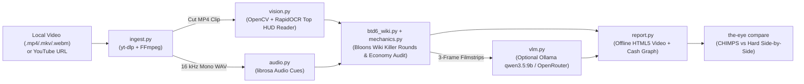

# The-Eye

**Bloons TD 6 (BTD6)** Strategy, Economy & Bloons Wiki Checkpoint Analyzer that processes recorded gameplay videos (local files or YouTube URLs) using **FFmpeg**, **OpenCV**, **RapidOCR**, **librosa**, and optional **Vision-Language Models (local Ollama `qwen3.5:9b` or OpenRouter)** to read exact **Lives**, **Cash (`$`)**, **Round (`X/Y`)**, and **Active Tower Upgrades** straight from the HUD, cross-reference against **Bloons Wiki Killer Rounds**, and compare two strategies side-by-side.

---

## Architecture



### What It Extracts Directly From On-Screen Pixels
- **HUD Telemetry (`vision.py` via RapidOCR):** Reads **Lives**, **Cash (`$`)**, **Round (`X/100` or `X/80`)**, and **Selected Tower Panel Names** (`Monkey Village`, `Banana Farm`, `Alchemist`, `Sauda`, etc.) cleanly even as BTD6 shifts the top HUD when left/right upgrade panels open.
- **Bloons Wiki Checkpoint Auditor (`btd6_wiki.py` + `mechanics.py`):**
  - Cross-references every round reached against iconic BTD6 Wiki killer rounds (**R24 Camo**, **R28 Lead**, **R33 Camo Rush**, **R40 First MOAB**, **R59 Camo Leads**, **R63 Ceramic Rush**, **R76/R78 Ceramics**, **R80 ZOMG**, **R90/R95/R99 DDTs**, **R98 RBE**, **R100 BAD**).
  - Tracks **exact Lives Lost (Bloon Leaks)** + how much **unspent cash** was sitting in the bank at the exact second of the leak.
  - Builds a timestamped **Build Order & Cash Economy Timeline** (`Total Cash Invested`, `Upgrades / Placements`, `Peak Unspent Cash`, `Eco Farming` detection, and `Cash Hoarding` warnings).
- **Player-First Interactive HTML Report (`report.py`):**
  - Embedded offline **HTML5 `<video>` player** (`clip.mp4`) with exact clip-aligned **`▶ Jump MM:SS.s`** buttons pointing directly to the on-page video.
  - **Click-anywhere Cash (`$`) Over Time SVG Graph** with yellow Wiki Killer Round markers and red Bloon Leak markers.
  - **Player View (Simple) ↔ Coach View (Advanced)** toggle + **3-Frame Moment Filmstrips** (`BEFORE | MOMENT | AFTER`).

---

## Quick Start

### Prerequisites
- Python `3.12+`, [`uv`](https://docs.astral.sh/uv/), and `ffmpeg` on `PATH`
- Optional: [Ollama](https://ollama.com/) (`ollama pull qwen3.5:9b`) or `OPENROUTER_API_KEY` in `.env` for VLM strategy coaching (or pass `--no-vlm` for pure OpenCV + RapidOCR + Bloons Wiki).

### Install
```bash
uv sync --extra dev
cp .env.example .env
```

### Analyze Two BTD6 Recordings on the Same Map & Compare Side-by-Side
Supported inputs: local files (`.mp4`, `.mkv`, `.webm`, `.mov`, `.avi`) or YouTube URLs.

```bash
# 1. Downstream [CHIMPS] (2.5-minute midgame excerpt covering R24-R40+)
uv run the-eye analyze "https://www.youtube.com/watch?v=nhcA10kWtkA" \
  --title "Downstream [CHIMPS]" \
  --start 150 --duration 150 --fps 2.0 \
  --model "ollama:qwen3.5:9b" \
  --out output/btd6_chimps

# 2. Downstream [Hard] (2.5-minute midgame excerpt on the same map)
uv run the-eye analyze "https://www.youtube.com/watch?v=4-cT9n8QNAk" \
  --title "Downstream [Hard]" \
  --start 150 --duration 150 --fps 2.0 \
  --model "ollama:qwen3.5:9b" \
  --out output/btd6_hard

# 3. Side-by-side comparison
uv run the-eye compare \
  output/btd6_chimps/report.json \
  output/btd6_hard/report.json \
  --out output/compare_btd6.html
```

---

## Included Demo Catalog ([catalog/btd6_videos.json](catalog/btd6_videos.json))

| Recording | Mode | Map | Source URL | Excerpt Start | Duration |
| :--- | :--- | :--- | :--- | :---: | :---: |
| **Downstream [CHIMPS]** | CHIMPS (`100` Rounds, `1` Life) | Downstream | `https://www.youtube.com/watch?v=nhcA10kWtkA` | `02:30` (`150s`) | `150s` |
| **Downstream [Hard]** | Hard (`80` Rounds, `100` Lives) | Downstream | `https://www.youtube.com/watch?v=4-cT9n8QNAk` | `02:30` (`150s`) | `150s` |

---

## Testing & Linting

```bash
uv run ruff check src tests
uv run pytest -v
```
