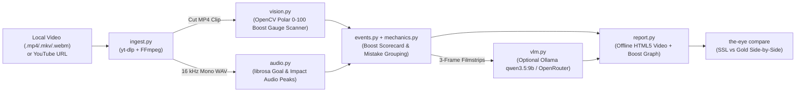

# The-Eye

Rocket League **Boost Discipline & Gameplay Analyzer** that processes recorded POV footage (local files or YouTube URLs) using **FFmpeg**, **OpenCV**, **librosa**, and optional **Vision-Language Models (local Ollama `qwen3.5:9b` or OpenRouter)** to read the on-screen **0–100 Boost Gauge** directly from pixels, pinpoint boost starvation and panic burnouts, and compare two recordings side-by-side.

---

## Architecture



### What It Measures Directly From On-Screen Pixels
- **0–100 Boost Gauge Polar Scanner (`vision.py`):** Scans 100 angular bins along Rocket League's locked bottom-right circular Boost Gauge (`102° → 306°`, `204°` sweep) in HSV space — **±2 boost accuracy** with zero OCR or ML, while automatically detecting and excluding goal replays (`hud_visible=False`).
- **Boost Discipline Scorecard (`mechanics.py`):**
  - **Average Boost Held** (`0–100`)
  - **% Time Boost-Starved (`<= 12` boost)** & total seconds starved
  - **% Time Over-Capped (`>= 96` boost)** & passive stretches
  - **Small-Pad (`+12`) vs. Big-Pad (`+100`) Pickups**
  - **Panic Burnouts** (burning `>= 55` boost straight down to `<= 12` in `<= 3.5s`)
  - **Average Recovery Time** (seconds from `<= 15` back to `>= 35` boost)
- **Player-First Interactive HTML Report (`report.py`):**
  - Embedded offline **HTML5 `<video>` player** (`clip.mp4`) with 1-click **`▶ Jump MM:SS.s`** buttons on every mistake, event card, and Boost-Over-Time graph marker.
  - **Player View (Simple) ↔ Coach View (Advanced)** toggle so players see their Boost Grade (`S/A/B/C/D`), Boost-Over-Time graph, and clickable mistakes without debug clutter.
  - **3-Frame Moment Filmstrips (`BEFORE -1.5s | MOMENT 0.0s | AFTER +1.0s`)** showing the exact in-game boost gauge number for instant visual verification.

---

## Quick Start

### Prerequisites
- Python `3.12+`, [`uv`](https://docs.astral.sh/uv/), and `ffmpeg` on `PATH`
- Optional: [Ollama](https://ollama.com/) (`ollama pull qwen3.5:9b`) or `OPENROUTER_API_KEY` in `.env` for VLM coaching (or pass `--no-vlm` for pure OpenCV + `librosa`).

### Install
```bash
uv sync --extra dev
cp .env.example .env
```

### Analyze Two Rocket League Recordings & Compare Side-by-Side
Supported inputs: local files (`.mp4`, `.mkv`, `.webm`, `.mov`, `.avi`) or YouTube URLs.

```bash
# 1. SSL 2v2 POV (2000+ MMR, 2-minute excerpt)
uv run the-eye analyze "https://www.youtube.com/watch?v=5X77jb5DR6I" \
  --title "SSL 2v2 POV (2000+ MMR)" \
  --start 60 --duration 120 --fps 2.0 \
  --model "ollama:qwen3.5:9b" \
  --out output/rl_ssl_2v2

# 2. Gold 3 POV (2-minute excerpt)
uv run the-eye analyze "https://www.youtube.com/watch?v=0euux689wVY" \
  --title "Gold 3 POV" \
  --start 60 --duration 120 --fps 2.0 \
  --model "ollama:qwen3.5:9b" \
  --out output/rl_gold3

# 3. Side-by-side comparison
uv run the-eye compare \
  output/rl_ssl_2v2/report.json \
  output/rl_gold3/report.json \
  --out output/compare_rl.html
```

---

## Included Demo Catalog ([catalog/rl_videos.json](catalog/rl_videos.json))

| Recording | Rank Tier | Source URL | Excerpt Start | Duration |
| :--- | :--- | :--- | :---: | :---: |
| **SSL 2v2 POV (2000+ MMR)** | Supersonic Legend | `https://www.youtube.com/watch?v=5X77jb5DR6I` | `01:00` (`60s`) | `120s` |
| **Gold 3 POV (No Commentary)** | Gold 3 | `https://www.youtube.com/watch?v=0euux689wVY` | `01:00` (`60s`) | `120s` |

---

## Testing & Linting

```bash
uv run ruff check src tests
uv run pytest -v
```
