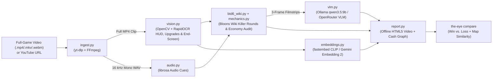

# The-Eye

**Bloons TD 6 (BTD6)** Full-Game Strategy, Economy, Image-Similarity & Bloons Wiki Analyzer that processes recorded gameplay videos (local files or YouTube URLs) using **FFmpeg**, **OpenCV**, **RapidOCR**, **librosa**, **Multimodal Image Embeddings (`fastembed` ONNX CLIP / Google `gemini-embedding-2-preview`)**, and **Vision-Language Models (local Ollama `qwen3.5:9b` or OpenRouter)** — using gameplay videos as its **only** source of game data.

---

## Architecture



### What It Extracts Directly From On-Screen Pixels
- **Full-Game HUD & Upgrade Panel OCR (`vision.py` via RapidOCR):**
  - Reads **Lives**, **Cash (`$`)**, **Round (`X/Y`)**, **Active Tower Names**, and **Notable Upgrade Paths** (e.g., `Bloonjitsu (Ninja 4-x-x)`, `Counter-Espionage (Ninja x-2-x)`, `Stronger Stimulant (Alch 4-x-x)`).
  - Automatically detects **Victory / Defeat** end-screen banners directly from gameplay pixels.
  - Defaults to **full-game analysis (`--duration 0`)** with adaptive FPS (`0.5 fps` for full 6–25 min games, `1.0 fps` for shorter clips).
- **Multimodal Image-Similarity Embeddings (`embeddings.py`):**
  - Runs local ONNX vision embeddings (`fastembed:clip-ViT-B-32-vision`) out-of-the-box — or Google **`gemini-embedding-2-preview`** automatically when `GEMINI_API_KEY` is configured.
  - Fingerprints the playable map to verify **Same Map vs. Different Maps** and compare defense layouts at overlapping checkpoint rounds in `compare.html`.
  - Matches **unclicked tower placements** by cropping the changed map tile after a cash drop and comparing it via cosine similarity against previously observed towers.
- **Bloons Wiki Checkpoint Auditor (`btd6_wiki.py` + `mechanics.py`):**
  - Cross-references every round against iconic BTD6 Wiki killer rounds (**R24 Camo**, **R28 Lead**, **R33 Camo Rush**, **R40 First MOAB**, **R59 Camo Leads**, **R63 Ceramic Rush**, **R76/R78 Ceramics**, **R80 ZOMG**, **R90/R95/R99 DDTs**, **R98 RBE**, **R100 BAD**).
  - Flags **real Bloon leaks** and **Cash Hoarding** stretches with clickable timestamps and exact unspent cash in the bank.
- **Player-First Interactive HTML Report (`report.py`):**
  - Embedded offline **HTML5 `<video>` player** (`clip.mp4`) with exact clip-aligned **`▶ Jump MM:SS.s`** buttons.
  - **Click-anywhere Cash (`$`) Over Time SVG Graph** + **Player View (Simple) ↔ Coach View (Advanced)** toggle + **3-Frame Moment Filmstrips** (`BEFORE | MOMENT | AFTER`).

---

## Quick Start

### Prerequisites
- Python `3.12+`, [`uv`](https://docs.astral.sh/uv/), and `ffmpeg` on `PATH`
- Optional: [Ollama](https://ollama.com/) (`ollama pull qwen3.5:9b`) or `OPENROUTER_API_KEY` (loaded automatically from `.env` **or** OS Keyring — Windows Credential Manager / macOS Keychain — under `the-eye/openrouter`, `key:openrouter`, or `OPENROUTER_API_KEY`); optional `GEMINI_API_KEY` for `gemini-embedding-2-preview` (defaults to local ONNX `fastembed` with zero API key).

### Install
```bash
uv sync --extra dev
cp .env.example .env
```

### Analyze Two Full-Game BTD6 Recordings (Clean Win vs. Round 63 Loss) & Compare
Supported inputs: local files (`.mp4`, `.mkv`, `.webm`, `.mov`, `.avi`) or YouTube URLs.

```bash
# 1. Full-game clean Hard win (Downstream R3 -> R80)
uv run the-eye analyze "https://www.youtube.com/watch?v=4-cT9n8QNAk" \
  --title "Downstream [Hard] Full Game (R3-R80)" \
  --duration 0 --model "ollama:qwen3.5:9b" \
  --out output/btd6_hard_full

# 2. Full-game losing run with real leaks & Round 63 Ceramic Rush defeat
uv run the-eye analyze "https://www.youtube.com/watch?v=DgRRNP93XdU" \
  --title "Epic Loss On Round 63 (Full Game)" \
  --duration 0 --model "ollama:qwen3.5:9b" \
  --out output/btd6_r63_loss

# 3. Side-by-side strategy + visual map-similarity comparison
uv run the-eye compare \
  output/btd6_hard_full/report.json \
  output/btd6_r63_loss/report.json \
  --out output/compare_win_vs_loss.html
```

---

## Verified Full-Game Live Results ([catalog/btd6_videos.json](catalog/btd6_videos.json))

| Metric | Downstream [Hard] Full Game | Epic Loss On Round 63 (Full Game) |
| :--- | :--- | :--- |
| **Source URL** | `https://www.youtube.com/watch?v=4-cT9n8QNAk` | `https://www.youtube.com/watch?v=DgRRNP93XdU` |
| **Rounds Covered** | `R3 → R80` (Full 14m game) | `R1 → R63` (Full 22m game) |
| **Overall Strategy Score** | `76.2 / 100` | `29.9 / 100` |
| **Lives Lost (Leaks)** | `0` | `94` |
| **Cash Invested** | `$115,255` (`40` upgrades) | `$61,718` (`48` upgrades) |
| **Visual Map Similarity** | `81.1%` (**Different Maps** auto-detected) | `81.1%` (**Different Maps** auto-detected) |
| **VLM Coach** | `ollama:qwen3.5:9b` | `ollama:qwen3.5:9b` |

---

## Testing & Linting

```bash
uv run ruff check src tests
uv run pytest -v
```
